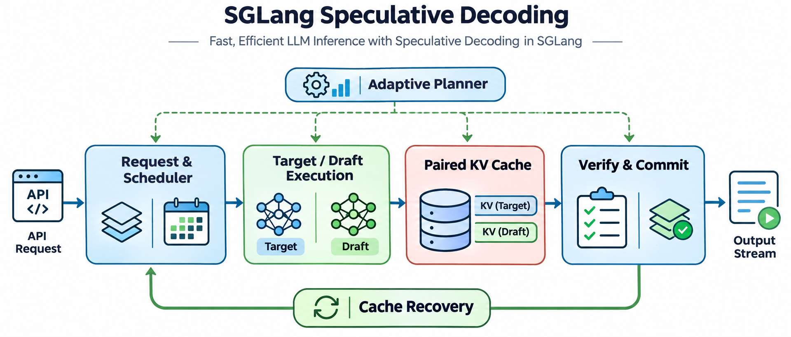
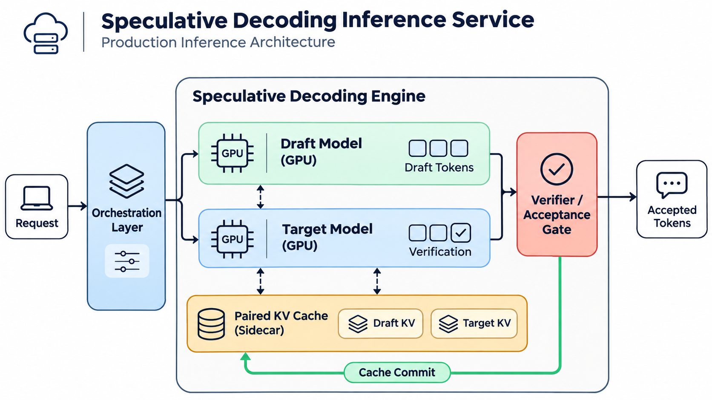
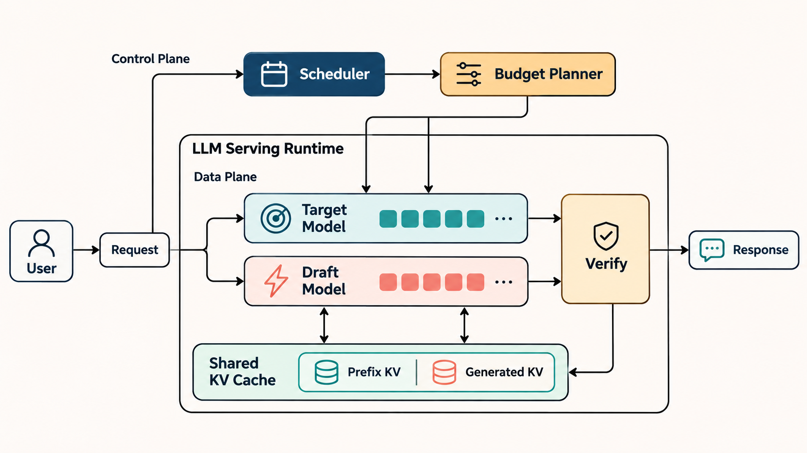

# SGLang / DSpark：推测解码推理优化

> 面向 Qwen3-14B 的 SGLang 推理优化项目：动态验证、成对前缀缓存、CUDA Graph、手写算子与低比特量化。

[](https://github.com/sgl-project/sglang)
[](https://www.python.org/)
[](https://developer.nvidia.com/cuda-toolkit)

## 项目简介

自回归生成每次只计算一个 token。DSpark 让 draft 模型连续提出候选，再由 target 模型批量验证，从而减少 target 解码轮数。本项目围绕这条执行链，针对真实服务中的三个瓶颈做优化：

- **动态验证**：根据请求数、survival probability 和 SPS step-time 选择 verify budget；
- **缓存复用**：同时管理 target KV 与 draft readiness，让热前缀可以安全复用；
- **执行效率**：为 ragged verify、KV 写回、acceptance finalize、CUDA Graph 和量化路径补齐运行时优化。

项目重点是把局部优化放进完整 SGLang 服务，测量它对 TTFT、TPOT、E2E、p95、显存和正确性的实际影响。

## 执行流程







## 核心改动

### 1. 动态验证 planner

`HostConfidenceBudgetPlanner` 使用历史 survival probability 和 SPS additive cost table 估计当前 batch 的最优验证长度，并根据实际 padding、graph tier 和 batch geometry 选择 compact 或 full verify。

本项目补充了三类能力：

- 缓存 additive step-time tensor，减少重复构造插值和代价张量；
- graph token 数、完整逻辑 token 数、最终执行路径和 planning 状态统一记录；
- adaptive draft 改变 candidate pool 后，自动扩容旧缓存，修复 `7 < 13` 长度错误。

### 2. Target / draft 成对前缀缓存

paired cache 使用 metadata sidecar 绑定 target radix node 和 draft readiness，不复制另一套 target KV。缓存条目记录：

- ready prefix 长度与 fingerprint；
- node split、delete、LRU 和 metadata budget；
- partial recovery 计划与实际执行状态；
- target 命中但 draft 未就绪时的安全回退路径。

只有 target 和 draft 状态同时满足条件，后缀才会进入复用路径。

### 3. 数值一致性与 CUDA Graph

项目先建立普通 target oracle，再定位并修复并发与串行路径的数值差异：

- FA2 automatic KV chunk 导致的分区差异；
- QKV projection 在不同 M 下的 GEMM 形状差异；
- FA4 decode / verify tile 不一致导致的 attention 差异。

在此基础上加入 exact geometry guard、host mirror bridge 和稳定的 FA4 tile policy，确保 graph 真的 replay，失败时安全回退 eager。

### 4. 手写算子与融合路径

- Triton：K RMSNorm + RoPE + KV write-back；greedy acceptance finalize；投影与 KV 写回融合实验；
- CUDA C++：compact scan、prefix sum、token gather；
- CUDA Graph：精确 capture/replay，记录实际 graph launch；
- FlashInfer / FA3 / FA4：按 workload 和 KV dtype 选择后端。

这些算子都通过了独立的正确性或服务冒烟检查，再进入端到端 A/B。

### 5. FP8、NVFP4 与 FP8 KV

- 原生 W8A8 FP8：target fused linear 使用 per-channel weight scale 和 per-token activation scale；
- NVFP4：接入 ModelOpt W4A4 checkpoint，并比较 CUTLASS、cuDNN 等执行后端；
- FP8 KV：新增 backend compatibility check。非 deterministic 场景下，FP8 KV + FA4 自动切换到支持 dequant 的 FlashInfer；deterministic + FA4 + FP8 KV 在启动阶段给出明确错误。

## 关键结果

| 方向 | 结果 | 测试条件 |
|---|---:|---|
| Planner CPU cache | 90.322 → 39.205 μs，约 **2.18–2.21×** | 同进程 survival tensor microbenchmark |
| Native FP8 target | E2E **降低 31.40%–31.66%** | Qwen3-14B，p2048/c1，128 output，ABBA |
| Native FP8 显存 | 峰值 **降低约 33.3%** | 同容量 KV 对照 |
| Paired cache + BF16 | E2E **降低 20.9%–24.8%** | p512/c4，100% 热前缀，32 measured requests |
| Paired cache + FP8 | E2E **降低 15.0%–16.8%** | 同协议 FP8 target |
| Exact target graph | E2E **降低 1.708%–1.992%** | p2048/c1，1×8 exact geometry |
| NVFP4 | 峰值显存约 **23.1 GiB** | DSpark 同协议矩阵；当前优势主要是容量 |

服务级结果统一记录 acceptance、TTFT、TPOT、E2E、p95、GPU step、显存和缓存命中。

## 两个最新故障修复

| 问题 | 修复 | 验证 |
|---|---|---|
| adaptive planner 缓存向量短于 candidate pool | 按当前 `resolved_max_verify_len()` 检查并扩容缓存 | adaptive + deterministic + FA4 + BF16 KV，8 请求通过 |
| BF16 Q 与 FP8 KV 在 FA4 中 dtype 不一致 | 非 deterministic 自动路由 FlashInfer；deterministic 组合启动期报错 | FP8 KV + paired cache，8 请求通过，cached tokens=3529 |

详细说明见 [BUG_FIXES_ADAPTIVE_KV_20261117.md](benchmark/dspark/BUG_FIXES_ADAPTIVE_KV_20261117.md)。

## 快速开始

仓库提供 DSpark 增量 patch、实验协议和结果。先准备匹配版本的 SGLang、模型、draft 模型和 SPS table：

```bash
git clone https://github.com/Nemurizz/SGLang-DSpark-.git /path/to/dspark
git clone https://github.com/sgl-project/sglang.git /path/to/sglang
cd /path/to/sglang

git apply --check /path/to/dspark/sglang-dspark-dynamic-verification.patch
git apply /path/to/dspark/sglang-dspark-dynamic-verification.patch

python -m sglang.launch_server \
  --model-path /path/to/Qwen3-14B \
  --speculative-algorithm DSPARK \
  --speculative-draft-model-path /path/to/dspark_qwen3_14b_block7 \
  --speculative-num-draft-tokens 8
```

FP8 KV 推荐使用 FlashInfer 路径：

```bash
python -m sglang.launch_server \
  --model-path /path/to/Qwen3-14B \
  --kv-cache-dtype fp8_e4m3 \
  --attention-backend flashinfer \
  --prefill-attention-backend flashinfer \
  --decode-attention-backend flashinfer
```

## 实验文档

| 文档 | 内容 |
|---|---|
| [BUG_FIXES_ADAPTIVE_KV_20261117.md](benchmark/dspark/BUG_FIXES_ADAPTIVE_KV_20261117.md) | adaptive planner 与 FP8 KV 修复 |
| [CACHE_CORRECTNESS_AND_COMBINATIONS_20261117.md](benchmark/dspark/CACHE_CORRECTNESS_AND_COMBINATIONS_20261117.md) | paired cache 正确性与组合开关 |
| [CACHE_HIT_RATE_MIXED_SWEEP_20261117.md](benchmark/dspark/CACHE_HIT_RATE_MIXED_SWEEP_20261117.md) | 不同前缀复用率 |
| [CACHE_PRIME_EVICTION_20261117.md](benchmark/dspark/CACHE_PRIME_EVICTION_20261117.md) | prime、eviction、recovery 生命周期 |
| [CACHE_ARRIVAL_RATE_REPLAY_20261117.md](benchmark/dspark/CACHE_ARRIVAL_RATE_REPLAY_20261117.md) | 到达率回放 |
| [CACHE_GPU_SATURATION_20261117.md](benchmark/dspark/CACHE_GPU_SATURATION_20261117.md) | GPU 饱和度与缓存行为 |
| [NVFP4_DSPARK_FP8_SAME_PROTOCOL_20261108.md](benchmark/dspark/NVFP4_DSPARK_FP8_SAME_PROTOCOL_20261108.md) | NVFP4 / FP8 同协议比较 |
| [NVFP4_SMALL_M_KERNEL_EXPERIMENT_20261113.md](benchmark/dspark/NVFP4_SMALL_M_KERNEL_EXPERIMENT_20261113.md) | 小 M FP4 kernel 探索 |
| [sglang-dspark-dynamic-verification.patch](sglang-dspark-dynamic-verification.patch) | 动态验证增量 patch |

## 仓库结构

```text
sglang-dspark-dynamic-verification.patch   动态验证与 planner patch
benchmark/dspark/                          实验协议、结果和复现记录
results/                                   SPS probe、ABBA 和服务日志
sglang/                                    早期 SGLang 源码快照
SHA256SUMS                                 公开材料校验
```

## 后续方向

- 用真实业务 trace 重放 prefix hit、arrival rate、eviction 和 recovery；
- 为 NVFP4 的小 M verify geometry 融合 block-scale load、layout transform 和 GEMM；
- 将 GPU busy、queue wait、planner cost 和 cache admission 纳入统一 runtime controller；
- 补齐多卡、长上下文和真实任务质量回归。

## License

本项目基于 [SGLang](https://github.com/sgl-project/sglang) 及其推理、缓存、attention 和量化生态，遵循仓库中的 [LICENSE](LICENSE)。
